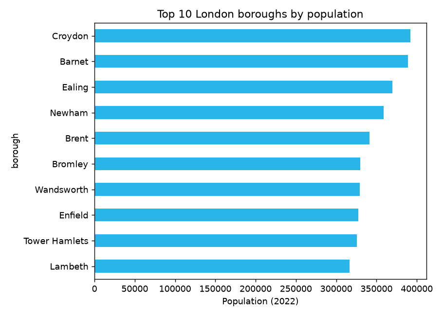
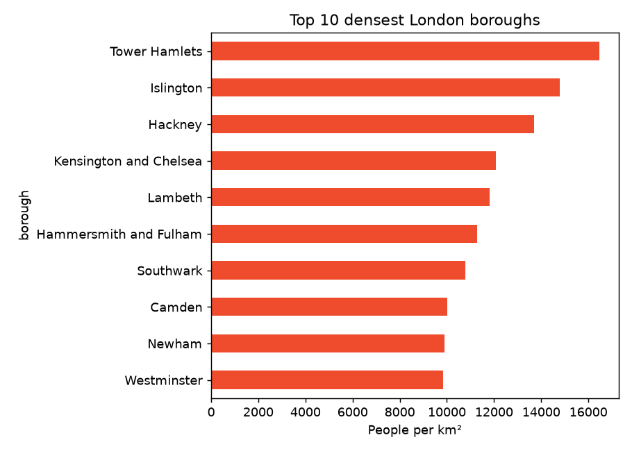
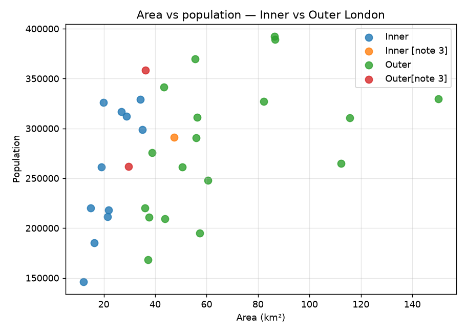
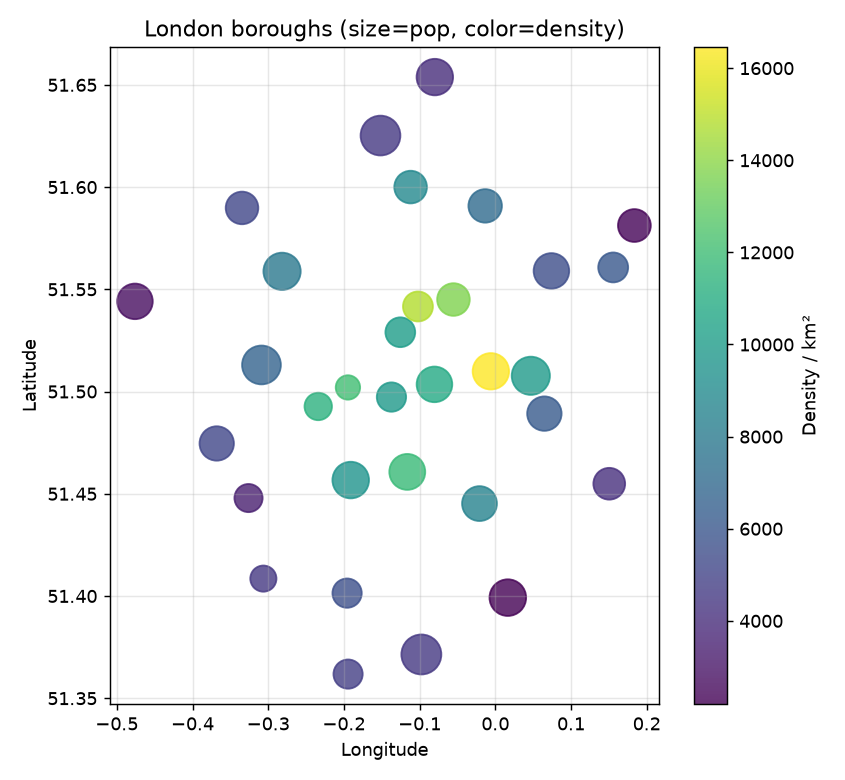

# 🏙️ London Boroughs - Population & Density Analysis

An interactive **data-visualization** project on Greater London's **32 boroughs**: how population, area and density vary across the city, Inner vs Outer London, and the political map - built from public data with a reproducible pipeline.


---

## 💡 Key insights

- 👥 **8.85M people** across 32 boroughs. The most populous is **Croydon (~392k)**.
- 🏢 **Density varies ~7×** - **Tower Hamlets (16,454/km²)** is the densest, **Bromley (2,196/km²)** the sparsest.
- 🎯 **Inner London is ~2.4× denser than Outer** (≈11,700 vs ≈4,800 people/km²) - the classic dense-core / spread-out-suburbs shape.
- 🗺️ Political control is fragmented: **Labour leads (12 boroughs)**, then no-overall-control (7) and Conservative (5).

|  |  |
|---|---|
|  |  |

---

## 🔧 Reproducible pipeline

```bash
pip install -r requirements.txt
python src/prepare_data.py     # scrape + clean -> data/london_boroughs.csv
python src/analysis.py         # compute insights + regenerate the charts
streamlit run app.py           # interactive dashboard (bar charts + live map)
```

- **`src/prepare_data.py`** - fetches the "List of London boroughs" table from Wikipedia, cleans it, extracts lat/lon and computes density.
- **`src/analysis.py`** - matplotlib charts + printed insights.
- **`app.py`** - a **Streamlit + Plotly** dashboard with filters and an OpenStreetMap map.

---

## 📊 Data

`data/london_boroughs.csv` - borough, designation (Inner/Outer), political control, area (km²), population (2022 est.), latitude, longitude, density. Source: Wikipedia (public).

---

## 📚 What this project demonstrates

- A **reproducible data pipeline** (fetch → clean → analyze → visualize)
- **Geospatial** thinking (coordinates, density, an interactive map)
- Clear **data storytelling** - turning a table into insights an audience can read
- Both **static** (matplotlib) and **interactive** (Plotly/Streamlit) visualization

---

## 📄 License

Released under the [MIT License](LICENSE).
